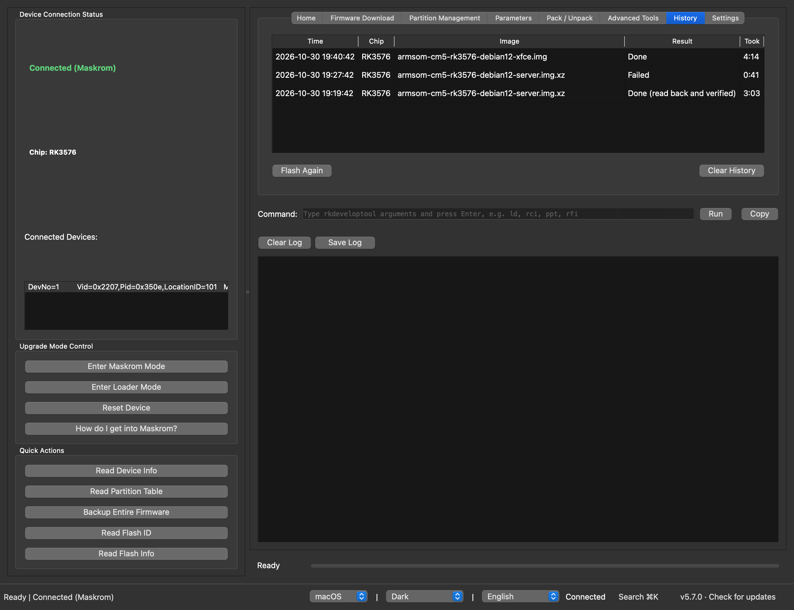
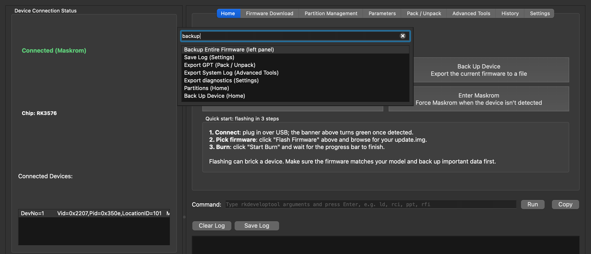
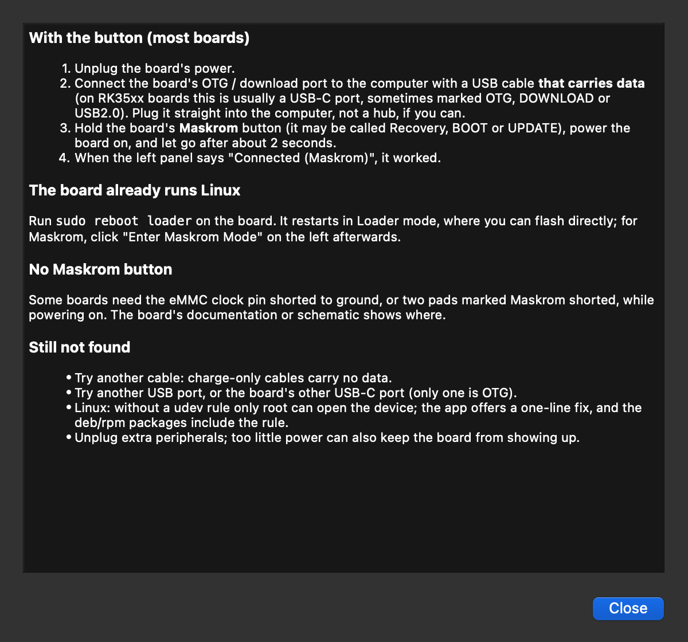

# RKDevelopTool GUI

[中文](README.zh.md) | English

A graphical front-end for Rockchip's `rkdeveloptool`, for macOS and Linux. It flashes firmware to Rockchip boards, manages their partitions and brings them back from Maskrom, without the command line. The prebuilt packages include rkdeveloptool, so there is nothing else to install.


## Install

**macOS and Linux, one line:**

```sh
curl -fsSL https://raw.githubusercontent.com/gahingwoo/RKDevelopTool-GUI/main/install.sh | sh
```

It picks the package for your system, checks it against the SHA-256 checksum GitHub publishes, and installs it:

- macOS: the app goes into `/Applications`, and opens without the "cannot be opened" warning.
- Debian/Ubuntu, Fedora/openSUSE: the `.deb` or `.rpm`, through apt, dnf or zypper (it asks for your password). It includes the USB rule, so the board shows up without sudo.
- Other Linux, or with `PACKAGE=appimage`: the AppImage in `~/.local/bin` with a menu entry, no root needed.

[Read the script](install.sh) first if you like.

**Homebrew (macOS):**

```sh
brew trust gahingwoo/tap
brew install --cask gahingwoo/tap/rkdeveloptool-gui
```

Homebrew only loads casks from taps you trust, hence the first line.

**Download:** every [release](https://github.com/gahingwoo/RKDevelopTool-GUI/releases) has these files.

| Platform | File |
| --- | --- |
| macOS (Apple Silicon) | `RKDevelopTool-GUI-arm64.dmg` |
| macOS (Intel) | `RKDevelopTool-GUI-x86_64.dmg` |
| Linux, portable (x86_64 / arm64) | `RKDevelopTool-GUI-*-x86_64.AppImage` / `*-aarch64.AppImage` |
| Debian/Ubuntu (amd64 / arm64) | `rkdeveloptool-gui_*.deb` |
| Fedora/openSUSE (x86_64 / aarch64) | `rkdeveloptool-gui-*.rpm` |

> **macOS, first launch from the DMG:** the app isn't notarized yet, so macOS says it can't be opened. On macOS 15 (Sequoia) and later, open **System Settings → Privacy & Security**, scroll down and click **Open Anyway**. On older versions, right-click the app, then **Open** and **Open** again. This is needed once; the app's own updates don't trigger it. The one-line installer and Homebrew skip this step.

**Updates:** the app updates itself. When a new release is out, **Download and Install** in the update dialog fetches it, checks it and restarts. To look now, click the version in the bottom-right corner. The automatic check runs at most once a day, sends one request to GitHub's Releases API and nothing else, and can be turned off in Settings.

## What it does

**Flashing**
- Flash an `update.img` (RKFW, including images over 4 GiB), a raw disk image, or a compressed `.img.xz`, `.img.gz` or `.img.bz2`, which is decompressed first.
- Before every write, a check: is a board connected, is a Loader running, does the image suit the address, does it fit in the storage. A failed check stops the write.
- One progress bar for the whole job, with speed and time left, and a Cancel button.
- Read the image back afterwards and compare, for single images and for each partition of an `update.img`.
- The partition table is saved before anything overwrites it, so Import GPT can put it back.
- In Maskrom the Loader is loaded for you: yours, or one built for your chip from Rockchip's [rkbin](https://github.com/rockchip-linux/rkbin) with **Get Loader for This Chip**.
- **Reset Board** when it's done, and the new system boots.

**Many boards**
- The production line flashes the same image onto boards one after another: plug one in, wait for "unplug", plug in the next. Each gets its Loader, the write, an optional read-back and a reset.

**When you're new to this**
- A first-run guide checks your setup and walks through a flash.
- **How do I get into Maskrom?** covers the button, boards that already run Linux, boards without a button, and what to check when nothing shows up.
- **Search** (⌘K on macOS, Ctrl+K elsewhere) finds any button or setting in English or Chinese, or by everyday words like "flash", "backup" or "unbrick", and takes you to it.
- Errors come with the likely cause and what to try. **Report a Problem** opens a GitHub issue with the details filled in.

**Everything else**
- The **History** tab lists every flash; **Flash Again** puts the image back.
- Partition table: read it, then flash, back up or erase single partitions.
- A command line for any rkdeveloptool command, showing the command behind each button.
- Drag a firmware, Loader or other file onto the window and it goes to the right field.
- A desktop notification when a flash ends in the background.
- Light and dark themes, adjustable text size, English and Chinese.

| Check before writing | History |
| --- | --- |
|  |  |

| Search | Getting into Maskrom |
| --- | --- |
|  |  |

## Usage

### Flashing a board

1. Put the board into Maskrom mode: with the USB cable in the board's OTG / download port, hold its Maskrom (or Recovery) button while you power it on. The left panel shows "Connected (Maskrom)". If it doesn't, click **How do I get into Maskrom?**.
2. Drag the firmware onto the window, or choose it on the **Firmware Download** tab. An `update.img`, a raw `.img` or a compressed `.img.xz` all work.
3. An `update.img` brings its own Loader. For anything else, choose the Loader for your chip, for example `rk3588_spl_loader_*.bin`, or click **Get Loader for This Chip**. The write loads it when it's needed.
4. Click **Start One-Click Burn** (for an `update.img`) or **Burn Image**. Read the check results and confirm. You can tick "Read back and verify".
5. When it's done, click **Reset Board**. **Cancel** stops a write, but then the board needs flashing again before it boots.

### Many boards

rkdeveloptool works with one connected board at a time, so the production line on the **Advanced Tools** tab takes them one after another. Choose the image, click **Start Line**, then plug in boards in Maskrom one at a time. Unplug each when the line says so. Results are listed per board.

### Partitions

1. With the Loader running, click **Read Partition Table**.
2. On the **Partition Management** tab, flash, back up or erase a partition from its row.

Before a full flash or **Import GPT** writes a new table, the old one is saved as a parameter file; the log says where. Import GPT restores it.

### Commands

The **Command** field above the log shows the rkdeveloptool command behind each button. Type or edit a command there and press Enter, for example `ld`, `rci` or `ppt`. Commands that write or erase ask first.

### Settings

The **Settings** tab (Ctrl+, or ⌘,) has the style, theme, language and text size, which rkdeveloptool to use, a default Loader, where to decompress images, notifications, debug logging and updates. It can also reopen the first-run guide.

### If something fails

The app explains the common rkdeveloptool errors: no device found, the device can't be opened, the wrong Loader, a write that failed. Each comes with what to try, and rkdeveloptool's own output is under **Show Details**. **Report This Problem** in the error dialog, or **Report a Problem…** in Settings, opens a GitHub issue with the board, the environment and the end of the log. You see everything before it's sent.

## Linux: USB access

Without a udev rule only root can open a Rockchip device, and the board won't show up. The `.deb` and `.rpm` packages install the rule. With the AppImage or pip, the first-run guide and the app both notice and give you a one-line command. To install the rule yourself:

```bash
echo 'SUBSYSTEM=="usb", ATTR{idVendor}=="2207", TAG+="uaccess"' | sudo tee /etc/udev/rules.d/70-rkdeveloptool-gui.rules
sudo udevadm control --reload-rules && sudo udevadm trigger
```

Then unplug and replug the board.

## Other ways to install

### pip

The wheel adds the `rkdeveloptool-gui` command. Unlike the packages above it doesn't include `rkdeveloptool`, so install that separately ([instructions](https://docs.radxa.com/en/zero/zero3/low-level-dev/rkdeveloptool)) and check it with `rkdeveloptool --version`.

```bash
git clone https://github.com/gahingwoo/RKDevelopTool-GUI
cd RKDevelopTool-GUI
pip install .
rkdeveloptool-gui
```

### From source

Python 3.9 or later, PySide6, and `rkdeveloptool` on PATH:

```bash
git clone https://github.com/gahingwoo/RKDevelopTool-GUI
cd RKDevelopTool-GUI
pip install -r requirements.txt
python rkdevtoolgui.py
```

To build a standalone app: `python build_nuitka.py`.

### Arch Linux

From the AUR:

```bash
yay -S rkdeveloptool-gui
```

Or from a community repository: `sudo pacman -S rkdeveloptool-gui`, or the [self-hosted package repository](https://github.com/taotieren/aur-repo). [Repology](https://repology.org/project/rkdeveloptool-gui/versions) lists other distributions.

## Important notice

This is a graphical wrapper around rkdeveloptool. Flashing firmware is risky: done wrong, it can leave a board unbootable or lose its data. Before you start, back up what matters, use a good USB cable and a stable power supply, and check that the firmware is for your board.

The author is not responsible for damage to devices, lost data or other consequences of using this software.

## Contributing and support

Issues and pull requests are welcome: [github.com/gahingwoo/RKDevelopTool-GUI/issues](https://github.com/gahingwoo/RKDevelopTool-GUI/issues). The README screenshots are made by `docs/make_screenshots.py`.

## License

See [LICENSE](LICENSE).
