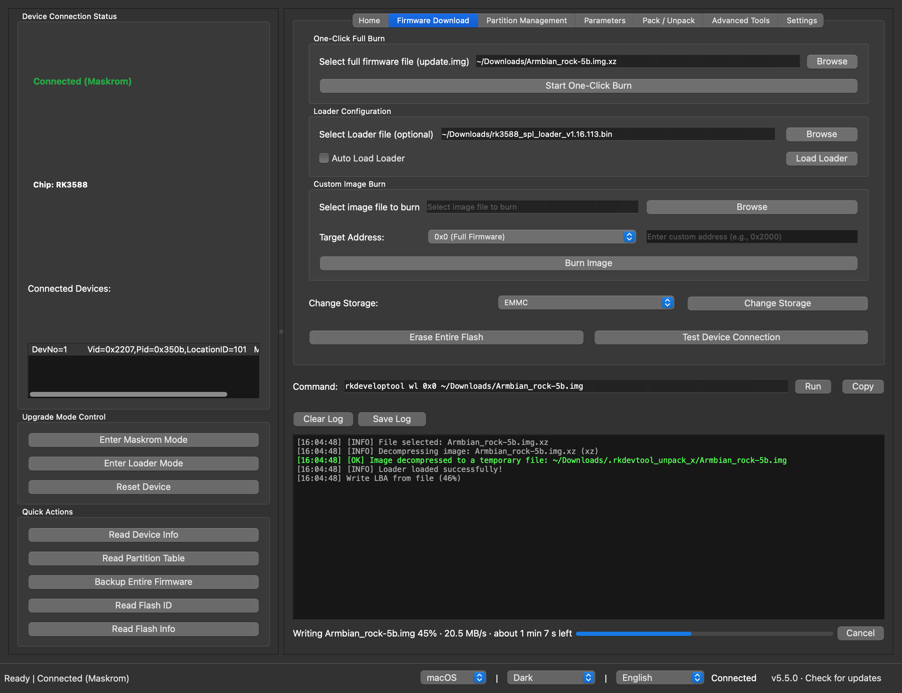
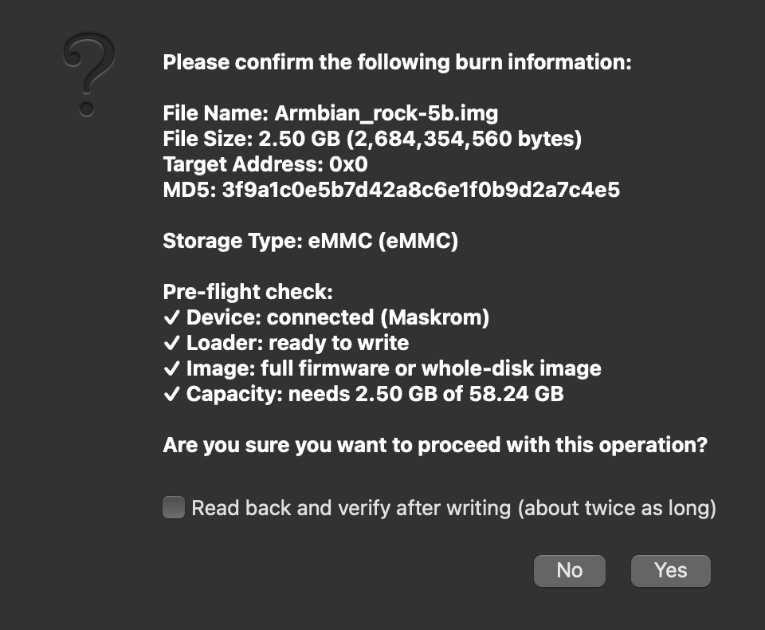
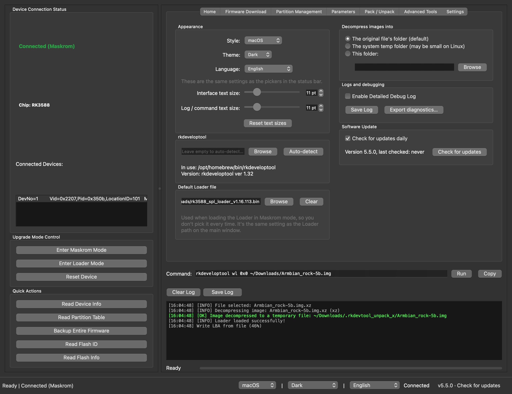

# RKDevelopTool GUI

[中文](README.zh.md) | English

RKDevelopTool GUI is a graphical front-end for Rockchip's rkdeveloptool, for Linux and macOS. It flashes firmware to Rockchip boards, manages their partitions and recovers them from Maskrom, without the command line. The prebuilt packages include rkdeveloptool.

**GitHub:** https://github.com/gahingwoo/RKDevelopTool-GUI



## Features

**Flashing**
- One-click flashing of an `update.img` (RKFW, including images over 4 GiB), a raw disk image, or a compressed `.img.xz`, `.img.gz` or `.img.bz2`, which is decompressed first.
- A check before every write: device connected, Loader loaded, the right kind of image for the address, and enough storage for it. A failed check stops the write.
- Progress for the whole write with speed and time left, a Cancel button, and an optional read-back verification afterwards.
- An `update.img` brings its own Loader. For other images in Maskrom mode, the app offers to load yours and picks the right way to do it.
- No Loader for your chip? **Get Loader for This Chip** builds one from Rockchip's [rkbin](https://github.com/rockchip-linux/rkbin) repository.
- A production line for flashing the same image onto many boards, one after another.

**When something goes wrong**
- Failures come with the likely cause and what to try, instead of an exit code.
- If the board disconnects mid-write, the app stops and tells you how to recover it.

**Everything else**
- Drag a firmware, Loader or other file onto the window; it goes to the right field.
- Partition table: read it, then flash, back up or erase single partitions.
- A command line for any rkdeveloptool command, with history.
- A Settings tab: style, theme, language, text size, which rkdeveloptool to use, a default Loader, and where to decompress images.
- Update check against GitHub releases, and Chinese and English.

| Check before writing | Settings |
| --- | --- |
|  |  |

---

## Install in one line (macOS and Linux)

```sh
curl -fsSL https://raw.githubusercontent.com/gahingwoo/RKDevelopTool-GUI/main/install.sh | sh
```

It downloads the latest release for your machine, checks it against the
SHA-256 checksum GitHub publishes, and installs it: the app into
`/Applications` on macOS (no "cannot be opened" prompt this way), the AppImage
into `~/.local/bin` with a menu entry on Linux. [Read the script](install.sh)
first if you like.

## Download

Prebuilt packages are attached to every [GitHub Release](https://github.com/gahingwoo/RKDevelopTool-GUI/releases).
They **bundle `rkdeveloptool`**, so there is nothing else to install.

| Platform | File |
| --- | --- |
| macOS (Apple Silicon) | `RKDevelopTool-GUI-arm64.dmg` |
| macOS (Intel) | `RKDevelopTool-GUI-x86_64.dmg` |
| Linux (portable, x86_64 / arm64) | `RKDevelopTool-GUI-*-x86_64.AppImage` / `*-aarch64.AppImage` |
| Debian/Ubuntu (amd64 / arm64) | `rkdeveloptool-gui_*.deb` |
| Fedora/openSUSE (x86_64 / aarch64) | `rkdeveloptool-gui-*.rpm` |

To update, click "Check for updates" in the bottom-right corner. The app also
checks by itself at most once a day: one request to the GitHub Releases API,
and nothing else is sent. You can turn that off in Settings.

> **macOS, first launch from the DMG:** the app isn't notarized yet, so macOS
> says it can't be opened. On macOS 15 (Sequoia) and later, open **System
> Settings → Privacy & Security**, scroll down and click **Open Anyway**
> (right-click → Open no longer gets past this). On older versions,
> right-click the app → **Open** → **Open**. Or run
> `xattr -cr /Applications/RKDevelopTool-GUI.app`. This is only needed once:
> the app's own updates don't trigger it.

### Linux: USB access

Without a udev rule only root can open a Rockchip device, and the board won't
show up. The `.deb` and `.rpm` packages install the rule, so the logged-in user
has access straight away. With the AppImage or pip, the app notices when the
board is there but can't be opened, and gives you a one-line command to
install the rule. You can also install it yourself:

```bash
echo 'SUBSYSTEM=="usb", ATTR{idVendor}=="2207", TAG+="uaccess"' | sudo tee /etc/udev/rules.d/70-rkdeveloptool-gui.rules
sudo udevadm control --reload-rules && sudo udevadm trigger
```

Then unplug and replug the board.

---

## Install via pip

Install a standard Python wheel — this adds the `rkdeveloptool-gui` command to
your `PATH`. Unlike the prebuilt packages above, the wheel does **not** bundle
`rkdeveloptool`, so install that separately (see [Running from source](#running-from-source)
for the requirements).

```bash
git clone https://github.com/gahingwoo/RKDevelopTool-GUI
cd RKDevelopTool-GUI
pip install .
rkdeveloptool-gui
```

Or build a redistributable wheel and install it anywhere:

```bash
pip install build
python -m build --wheel
pip install dist/rkdeveloptool_gui-*.whl
```

---

## Running from source

If you run from source instead of a prebuilt package, you need:

- Python 3.9 or later, PySide6 (Qt 6 for Python)
- `rkdeveloptool` installed and on PATH — verify with `rkdeveloptool --version`
  ([installation instructions](https://docs.radxa.com/en/zero/zero3/low-level-dev/rkdeveloptool))

### From Source

```bash
git clone https://github.com/gahingwoo/RKDevelopTool-GUI
cd RKDevelopTool-GUI
pip install -r requirements.txt
python rkdevtoolgui.py
```

### Build Standalone Executable

```bash
python build_nuitka.py
./rkdevtoolgui
```

### Arch Linux

Available in AUR:
```bash
yay -S rkdeveloptool-gui
```

Or through a community repository:
```bash
sudo pacman -S rkdeveloptool-gui
```

For the packaging status across more distributions, please refer to [Repology](https://repology.org/project/rkdeveloptool-gui/versions)

Alternatively, you can install it via a [self-hosted package repository](https://github.com/taotieren/aur-repo)

---

## Usage

### Flashing a board

1. Put the board into Maskrom mode: hold its Maskrom (or Recovery) button while
   you plug in USB or power it on. The status bar shows "Connected (Maskrom)".
2. Drag the firmware onto the window, or choose it with **Browse** on the
   **Firmware Download** tab. An `update.img`, a raw `.img` or a compressed
   `.img.xz` all work.
3. For anything other than an `update.img` (which brings its own Loader),
   choose the Loader for your chip, for example `rk3588_spl_loader_*.bin`, and
   load it when the app asks, or with **Load Loader**. If you don't have one,
   **Get Loader for This Chip** downloads the parts from rkbin and builds it.
4. Click **Start One-Click Burn**. Review the check results and confirm. For
   a raw or compressed image you can also tick "Read back and verify".
5. Wait for it to finish. The bar covers the whole flash, and **Cancel**
   stops it, but a cancelled write has to be flashed again before the board
   boots.

### Many boards

rkdeveloptool works with one connected board at a time, so the production line
on the **Advanced Tools** tab takes boards one after another. Choose the image,
click **Start Line**, then plug in boards in Maskrom mode one at a time. Each
board gets its Loader (the one on the Firmware Download tab, or one built from
rkbin), a size check, the write, an optional read-back and a reset. When the
line says so, unplug it and plug in the next. Results are listed per board.

### Partitions

1. Load the Loader, then click **Read Partition Table**.
2. On the **Partition Management** tab, pick a partition and flash, back up or
   erase it.

### Commands

The **Command** field above the log shows the rkdeveloptool command behind
each button. You can type or edit a command there and run it with Enter, for
example `ld`, `rci` or `ppt`. Commands that write or erase ask first.

### Settings

The **Settings** tab (Ctrl+, or ⌘,) has the style, theme, language and text
size, the rkdeveloptool binary to use, a default Loader, where to decompress
images, debug logging and the update check. The style, theme and language
pickers are also in the status bar.

### If something fails

The app explains the most common rkdeveloptool errors: no device found, the
device can't be opened, the wrong Loader, a write that failed. Each comes with
what to try, and rkdeveloptool's own output is under **Show Details**. To
report a problem, use **Export diagnostics…** in Settings and attach the file
to an issue.

---

## Important Notice

This software is a graphical wrapper around rkdeveloptool. Firmware flashing is inherently risky and may result in device bricking or data loss if not performed correctly.

Before using this tool:
- Ensure you have a backup of important data
- Use a reliable USB cable and a stable power supply for the board
- Understand the implications of each operation
- Consult device-specific documentation if needed

The author is not responsible for any device damage, data loss, or other consequences resulting from the use of this software.

---

## Contributing

Contributions are welcome. Please feel free to submit issues or pull requests.

---

## License

See [LICENSE](LICENSE) file for details.

---

## Support

For issues, questions, or feature requests, please visit:
https://github.com/gahingwoo/RKDevelopTool-GUI/issues


