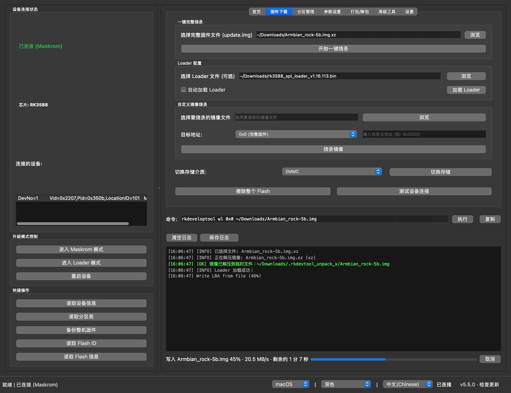
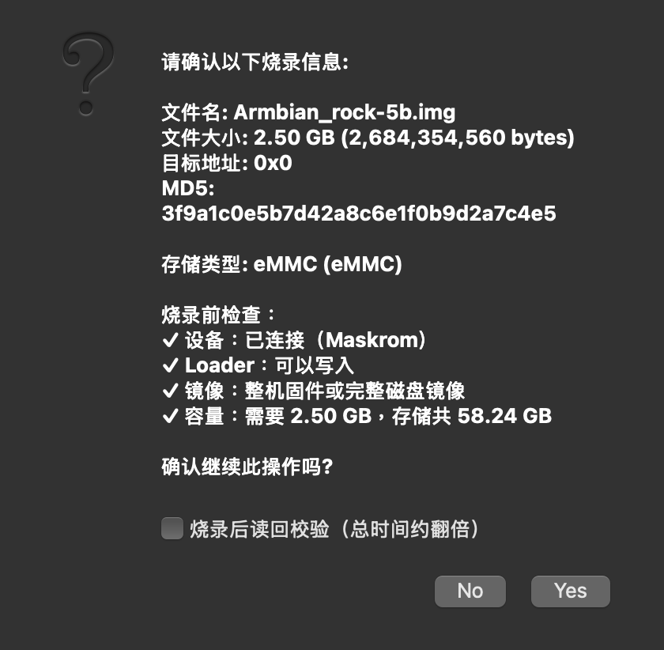
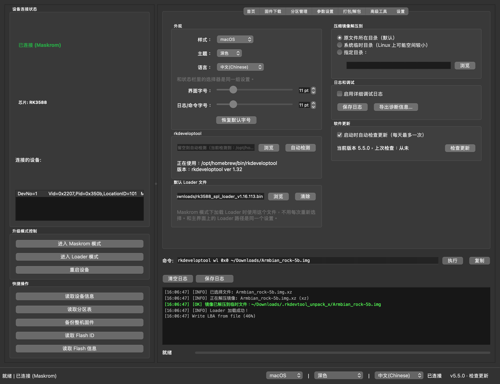

# RKDevelopTool GUI

[English](README.md) | 中文

RKDevelopTool GUI 是 Rockchip rkdeveloptool 的图形界面，适用于 Linux 和 macOS。不用敲命令，就能给 Rockchip 开发板烧录固件、管理分区，以及从 Maskrom 模式救砖。预编译安装包已经自带 rkdeveloptool。

**GitHub:** https://github.com/gahingwoo/RKDevelopTool-GUI



## 功能特性

**烧录**
- 一键烧录 `update.img`（RKFW 格式，支持 4 GiB 以上）、原始磁盘镜像，或者 `.img.xz`、`.img.gz`、`.img.bz2` 压缩镜像（会先自动解压）。
- 每次写入前先检查：设备是否连接、Loader 是否已加载、镜像类型是否适合写到这个地址、存储放不放得下。有一项不通过就不会开始写入。
- 显示整个烧录的总进度、速度和剩余时间，可以随时取消，写完还可以选择读回校验。
- `update.img` 自带 Loader；烧录其他镜像时，在 Maskrom 模式下应用会提示加载你的 Loader，并自动选用正确的加载方式。

**出问题时**
- 失败时会说明可能的原因和建议的操作，而不只是一个退出码。
- 写入过程中设备断开，应用会停下来，并告诉你怎么恢复。

**其他**
- 把固件、Loader 等文件直接拖到窗口上，会自动放进对应的输入框。
- 分区表：读取后可以单独烧录、备份或擦除某个分区。
- 命令行：可以执行任意 rkdeveloptool 命令，支持历史记录。
- 设置页：样式、主题、语言、字号、使用哪个 rkdeveloptool、默认 Loader、压缩镜像解压到哪里。
- 检查 GitHub 上的新版本；支持中文和英文界面。

| 烧录前检查 | 设置页 |
| --- | --- |
|  |  |

---

## 下载（推荐）

每个 [GitHub Release](https://github.com/gahingwoo/RKDevelopTool-GUI/releases) 都附带预编译包，**已自带 `rkdeveloptool`**，无需另外安装。

| 平台 | 文件 |
| --- | --- |
| macOS（Apple 芯片） | `RKDevelopTool-GUI-arm64.dmg` |
| macOS（Intel） | `RKDevelopTool-GUI-x86_64.dmg` |
| Linux（便携，x86_64 / arm64） | `RKDevelopTool-GUI-*-x86_64.AppImage` / `*-aarch64.AppImage` |
| Debian/Ubuntu（amd64 / arm64） | `rkdeveloptool-gui_*.deb` |
| Fedora/openSUSE（x86_64 / aarch64） | `rkdeveloptool-gui-*.rpm` |

点击右下角的「检查更新」即可检查新版本。应用也会自动检查，每天最多一次：只向 GitHub Releases API 发一个请求，不发送任何其他信息。可以在「设置」里关闭。

> **macOS 提示：** 应用尚未做公证，首次打开 macOS 可能提示「无法打开」。
> 右键应用 → **打开** → **打开**，或执行
> `xattr -cr /Applications/RKDevelopTool-GUI.app`。

### Linux：USB 访问权限

没有 udev 规则时，只有 root 能访问 Rockchip 设备，板子会显示不出来。`.deb` 和 `.rpm` 安装包会自动装好规则，当前登录的用户直接就能用。用 AppImage 或 pip 时，如果检测到板子已连接但打不开，应用会给出一条安装规则的命令。也可以自己安装：

```bash
echo 'SUBSYSTEM=="usb", ATTR{idVendor}=="2207", TAG+="uaccess"' | sudo tee /etc/udev/rules.d/70-rkdeveloptool-gui.rules
sudo udevadm control --reload-rules && sudo udevadm trigger
```

然后重新插拔开发板。

---

## 通过 pip 安装

构建并安装标准的 Python wheel 包，会把 `rkdeveloptool-gui` 命令加入 `PATH`。
与上面的预编译包不同，wheel **不**捆绑 `rkdeveloptool`，需要另行安装
（依赖见[从源码运行](#从源码运行)）。

```bash
git clone https://github.com/gahingwoo/RKDevelopTool-GUI
cd RKDevelopTool-GUI
pip install .
rkdeveloptool-gui
```

或先构建可分发的 wheel，再随处安装：

```bash
pip install build
python -m build --wheel
pip install dist/rkdeveloptool_gui-*.whl
```

---

## 从源码运行

若选择从源码运行（而非预编译包），需要：

- Python 3.8+、PySide6 (Qt 6 Python 绑定)
- 已安装并配置到 PATH 的 `rkdeveloptool` —— 用 `rkdeveloptool --version` 验证
  （[安装说明](https://docs.radxa.com/zero/zero3/low-level-dev/rkdeveloptool)）

### 从源码运行

```bash
git clone https://github.com/gahingwoo/RKDevelopTool-GUI
cd RKDevelopTool-GUI
pip install -r requirements.txt
python rkdevtoolgui.py
```

### 构建独立可执行文件

```bash
python build_nuitka.py
./rkdevtoolgui
```

### Arch Linux

在 AUR 中可用：
```bash
yay -S rkdeveloptool-gui
```

或通过社区仓库：
```bash
sudo pacman -S rkdeveloptool-gui
```

更多发行版的打包状态请查看 [Repology](https://repology.org/project/rkdeveloptool-gui/versions)。

另外也可通过 [自建源仓库](https://github.com/taotieren/aur-repo) 安装。

---

## 使用方法

### 烧录开发板

1. 让板子进入 Maskrom 模式：按住板子上的 Maskrom（或 Recovery）键，再插上 USB 或上电。状态栏会显示「已连接 (Maskrom)」。
2. 把固件拖到窗口上，或者在「固件下载」页点「浏览」选择。`update.img`、原始 `.img` 和压缩的 `.img.xz` 都可以。
3. 如果烧录的不是 `update.img`（它自带 Loader），请选择和芯片对应的 Loader，例如 `rk3588_spl_loader_*.bin`，在应用提示时加载，或者点「加载 Loader」。
4. 点「开始一键烧录」，看一下检查结果后确认。烧录原始镜像或压缩镜像时，还可以勾选「烧录后读回校验」。
5. 等待完成。进度条显示的是整个烧录的总进度；点「取消」可以中止，但被中止的写入需要重新烧录，板子才能正常启动。

### 分区

1. 先加载 Loader，再点「读取分区表」。
2. 在「分区管理」页选择分区，进行烧录、备份或擦除。

### 命令行

日志上方的「命令」栏会显示每个按钮背后实际执行的 rkdeveloptool 命令。你也可以在这里输入或修改命令，按回车执行，例如 `ld`、`rci`、`ppt`。会写入或擦除设备的命令，执行前会先确认。

### 设置

「设置」页（Ctrl+, 或 ⌘,）里有样式、主题、语言和字号，使用哪个 rkdeveloptool，默认 Loader，压缩镜像解压到哪里，调试日志和检查更新。样式、主题和语言在状态栏里也能直接切换。

### 出错时

对于最常见的 rkdeveloptool 错误（找不到设备、设备打不开、Loader 不对、写入失败等），应用会说明可能的原因和建议的操作，rkdeveloptool 的原始输出在「显示详细信息」里。反馈问题时，可以在「设置」里点「导出诊断信息…」，把导出的文件附到 issue 上。

---

## 重要提示

本软件是 rkdeveloptool 的图形化界面封装。固件烧录是一项风险操作，如果操作不当可能导致设备损坏或数据丢失。

使用本工具前，请：
- 确保已备份重要数据
- 使用可靠的 USB 线，并保证开发板供电稳定
- 了解每项操作的含义
- 必要时查阅设备相关文档

作者不对因使用本软件而导致的设备损坏、数据丢失或其他后果承担责任。

---

## 贡献

欢迎贡献代码。请提交 issue 或 pull request。

---

## 许可证

详见 [LICENSE](LICENSE) 文件。

---

## 技术支持

如有问题、疑问或功能建议，请访问：
https://github.com/gahingwoo/RKDevelopTool-GUI/issues


