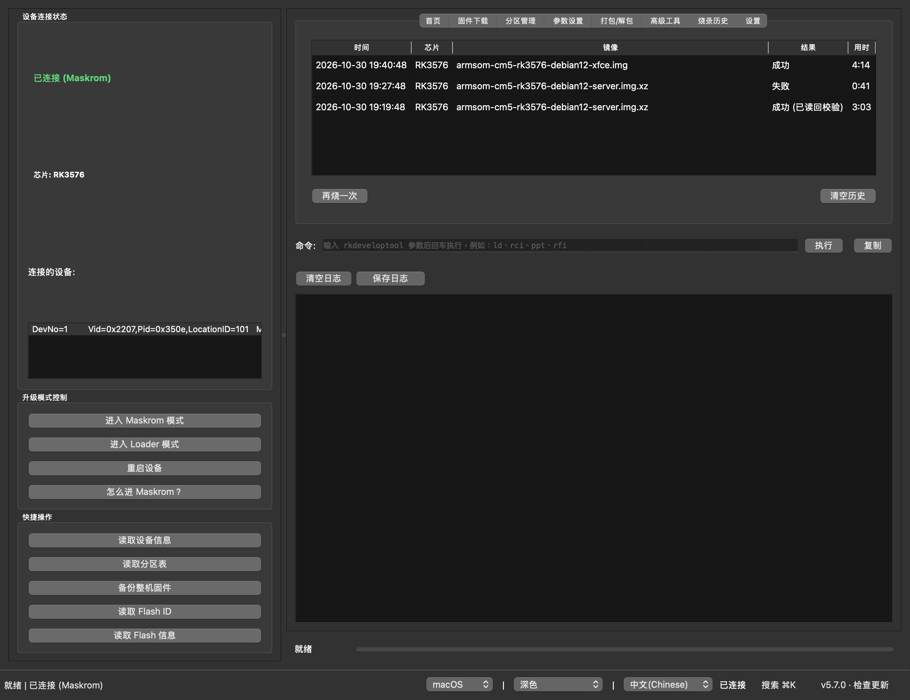
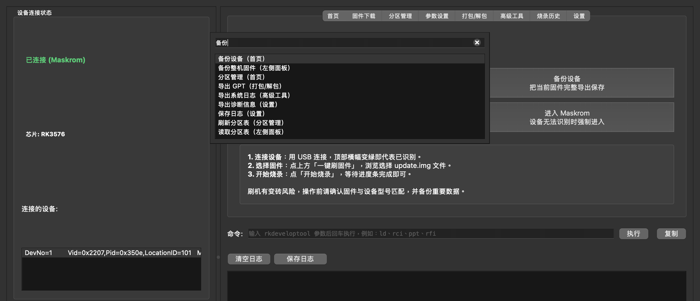
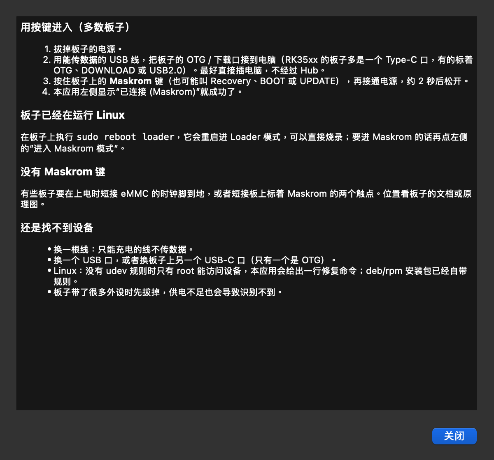

# RKDevelopTool GUI

[English](README.md) | 中文

Rockchip `rkdeveloptool` 的图形界面，支持 macOS 和 Linux。不用敲命令，就能给 Rockchip 开发板烧录固件、管理分区，以及从 Maskrom 模式救砖。预编译安装包自带 rkdeveloptool，不用另外安装。


## 安装

**macOS 和 Linux，一行命令：**

```sh
curl -fsSL https://raw.githubusercontent.com/gahingwoo/RKDevelopTool-GUI/main/install.sh | sh
```

它会自动选择适合你系统的安装包，用 GitHub 公布的 SHA-256 校验后再安装：

- macOS：应用装到 `/Applications`，打开时不会出现"无法打开"的提示。
- Debian/Ubuntu、Fedora/openSUSE：通过 apt、dnf 或 zypper 安装 `.deb` 或 `.rpm`（会要求输入密码）。安装包带 USB 规则，不用 sudo 就能识别开发板。
- 其他 Linux，或者设置了 `PACKAGE=appimage`：AppImage 装到 `~/.local/bin`，并添加菜单项，不需要 root。

想先看看脚本内容，可以[点这里](install.sh)。

**Homebrew（macOS）：**

```sh
brew trust gahingwoo/tap
brew install --cask gahingwoo/tap/rkdeveloptool-gui
```

Homebrew 只加载你信任过的第三方 tap，所以要先执行第一行。

**手动下载：** 每个 [Release](https://github.com/gahingwoo/RKDevelopTool-GUI/releases) 都有这些文件。

| 平台 | 文件 |
| --- | --- |
| macOS（Apple 芯片） | `RKDevelopTool-GUI-arm64.dmg` |
| macOS（Intel） | `RKDevelopTool-GUI-x86_64.dmg` |
| Linux 便携版（x86_64 / arm64） | `RKDevelopTool-GUI-*-x86_64.AppImage` / `*-aarch64.AppImage` |
| Debian/Ubuntu（amd64 / arm64） | `rkdeveloptool-gui_*.deb` |
| Fedora/openSUSE（x86_64 / aarch64） | `rkdeveloptool-gui-*.rpm` |

> **macOS 从 DMG 第一次打开：** 应用还没有经过公证，macOS 会提示无法打开。macOS 15（Sequoia）及以后：打开**系统设置 → 隐私与安全性**，滚到下面点**仍要打开**。更早的版本：右键点应用 →**打开**→ 再点**打开**。只需要做一次，应用自己的更新不会再触发。用一行命令或 Homebrew 安装就没有这一步。

**更新：** 应用会自己更新。有新版本时，在更新对话框里点**下载并安装**，它会下载、校验，然后重启。想马上检查，点右下角的版本号。自动检查每天最多一次，只向 GitHub 的 Releases API 发一个请求，不发送任何别的信息，可以在设置里关掉。

## 能做什么

**烧录**
- 烧录 `update.img`（RKFW 格式，支持 4 GiB 以上）、原始磁盘镜像，或者 `.img.xz`、`.img.gz`、`.img.bz2` 压缩镜像（先自动解压）。
- 每次写入前先检查：板子连上没有、Loader 在不在运行、镜像适不适合写到这个地址、存储放不放得下。有一项不通过就不会开始写。
- 整个任务一条进度条，显示速度和剩余时间，可以随时取消。
- 写完可以读回来比对，单个镜像可以，`update.img` 的每个分区也可以。
- 分区表在被覆盖之前会先备份，用"导入 GPT"就能恢复。
- Maskrom 模式下自动加载 Loader：用你选的，或者点**获取本芯片的 Loader**，从 Rockchip 的 [rkbin](https://github.com/rockchip-linux/rkbin) 为你的芯片生成一个。
- 刷完点**重启板子**，新系统就起来了。

**批量烧录**
- 流水线把同一个镜像一块接一块地烧到多块板子上：接上一块，等提示"拔下"，再接下一块。每块都会加载 Loader、写入、可选读回校验，然后重启。

**新手友好**
- 第一次打开有新手向导：检查环境，再带你走一遍刷机流程。
- **怎么进 Maskrom？** 讲了按键的方法、已经跑着 Linux 的板子怎么进、没有按键的板子怎么办，以及找不到设备时该检查什么。
- **搜索**（macOS 上按 ⌘K，其他系统按 Ctrl+K）：用中文、英文，或者"刷机""备份""救砖"这样的日常说法，找到任何按钮或设置，直接带你过去。
- 出错时说明可能的原因和该怎么做。**报告这个问题**会打开一个已经填好信息的 GitHub issue。

**其他**
- **烧录历史**页列出每一次烧录，**再烧一次**会把镜像填回去。
- 分区表：读取后可以单独烧录、备份或擦除某个分区。
- 命令行：可以执行任意 rkdeveloptool 命令，也能看到每个按钮背后实际执行的命令。
- 把固件、Loader 等文件拖到窗口上，会自动放进对应的输入框。
- 应用在后台时，刷机结束会发系统通知。
- 浅色和深色主题，可调字号，中文和英文界面。

| 烧录前检查 | 烧录历史 |
| --- | --- |
|  |  |

| 搜索 | 怎么进 Maskrom |
| --- | --- |
|  |  |

## 使用方法

### 烧录一块板子

1. 让板子进入 Maskrom 模式：USB 线接在板子的 OTG / 下载口上，按住 Maskrom（或 Recovery）键再上电。左侧会显示"已连接 (Maskrom)"。没反应的话，点**怎么进 Maskrom？**。
2. 把固件拖到窗口上，或者在**固件下载**页选择。`update.img`、原始 `.img`、压缩的 `.img.xz` 都可以。
3. `update.img` 自带 Loader。其他镜像要选对应芯片的 Loader，比如 `rk3588_spl_loader_*.bin`，或者点**获取本芯片的 Loader**。需要的时候，写入流程会自动加载它。
4. 点**开始一键烧录**（`update.img`）或**烧录镜像**。看一下检查结果，确认。可以勾选"烧录后读回校验"。
5. 完成后点**重启板子**。**取消**可以中止写入，但中止后要重新烧录，板子才能启动。

### 多块板子

rkdeveloptool 同一时间只能操作一块板子，所以**高级工具**页的流水线是一块接一块来的。选好镜像，点**开始流水线**，然后一次接一块处于 Maskrom 的板子，提示拔下时拔掉。每块板子的结果会单独列出。

### 分区

1. Loader 运行起来以后，点**读取分区表**。
2. 在**分区管理**页，从分区所在的那一行烧录、备份或擦除它。

全量烧录或**导入 GPT** 写入新分区表之前，旧的会先存成一个 parameter 文件，日志里会写明位置。用导入 GPT 导入它就能恢复。

### 命令行

日志上方的**命令**输入框会显示每个按钮背后的 rkdeveloptool 命令。也可以在这里输入或修改命令，回车执行，比如 `ld`、`rci`、`ppt`。会写入或擦除的命令会先确认。

### 设置

**设置**页（Ctrl+, 或 ⌘,）可以改样式、主题、语言和字号，选用哪个 rkdeveloptool、默认 Loader、压缩镜像解压到哪里，还有通知、调试日志和更新。也可以在这里重新打开新手向导。

### 出了问题

常见的 rkdeveloptool 错误，应用都会解释：找不到设备、设备打不开、Loader 不对、写入失败等等，并告诉你该试什么。rkdeveloptool 的原始输出在**显示详情**里。错误框里的**报告这个问题**，或者设置里的**报告问题…**，会打开一个 GitHub issue，带上板子、运行环境和日志末尾。发出去之前你能看到全部内容。

## Linux：USB 权限

没有 udev 规则时，只有 root 能打开 Rockchip 设备，板子就显示不出来。`.deb` 和 `.rpm` 安装包会装好规则。用 AppImage 或 pip 安装时，新手向导和应用都会发现这个问题，并给出一行修复命令。也可以自己装：

```bash
echo 'SUBSYSTEM=="usb", ATTR{idVendor}=="2207", TAG+="uaccess"' | sudo tee /etc/udev/rules.d/70-rkdeveloptool-gui.rules
sudo udevadm control --reload-rules && sudo udevadm trigger
```

然后把板子拔下来重新插上。

## 其他安装方式

### pip

wheel 会添加 `rkdeveloptool-gui` 命令。它和上面的安装包不同，不带 `rkdeveloptool`，需要另外安装（[安装说明](https://docs.radxa.com/en/zero/zero3/low-level-dev/rkdeveloptool)），装好后用 `rkdeveloptool --version` 确认。

```bash
git clone https://github.com/gahingwoo/RKDevelopTool-GUI
cd RKDevelopTool-GUI
pip install .
rkdeveloptool-gui
```

### 从源码运行

需要 Python 3.9 或更高版本、PySide6，以及在 PATH 里的 `rkdeveloptool`：

```bash
git clone https://github.com/gahingwoo/RKDevelopTool-GUI
cd RKDevelopTool-GUI
pip install -r requirements.txt
python rkdevtoolgui.py
```

打包成独立应用：`python build_nuitka.py`。

### Arch Linux

AUR：

```bash
yay -S rkdeveloptool-gui
```

也可以用社区仓库 `sudo pacman -S rkdeveloptool-gui`，或者[自建软件源](https://github.com/taotieren/aur-repo)。其他发行版的打包情况见 [Repology](https://repology.org/project/rkdeveloptool-gui/versions)。

## 重要提示

本软件是 rkdeveloptool 的图形界面。刷机有风险，操作不当可能导致板子无法启动或丢失数据。开始之前，请备份重要数据，使用质量好的 USB 线和稳定的电源，并确认固件和你的板子型号匹配。

作者不对使用本软件造成的设备损坏、数据丢失或其他后果负责。

## 参与和反馈

欢迎提交 issue 和 pull request：[github.com/gahingwoo/RKDevelopTool-GUI/issues](https://github.com/gahingwoo/RKDevelopTool-GUI/issues)。README 里的截图由 `docs/make_screenshots.py` 生成。

## 许可证

见 [LICENSE](LICENSE)。
